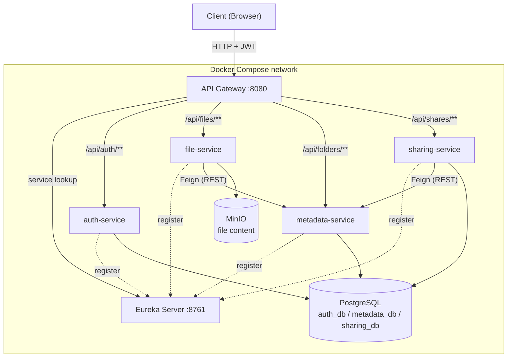

# CloudVault: Cloud Storage Platform

Web Technologies (TW) course project. Microservices-based client-server application.

## 1. Overview

CloudVault is a cloud file storage app (Google Drive / Dropbox style). Users upload files, organize them in folders, share them with others, and recover deleted files or older versions.

**Main features:** upload/download, nested folders, sharing with view/edit permissions, version history, trash bin.

**Microservices:**

| Service | Port | Responsibility | Storage |
| --- | --- | --- | --- |
| `eureka-server` | 8761 | Service Discovery: services register here and find each other by name | - |
| `api-gateway` | 8080 | Single entry point: routes requests to services, validates the JWT | - |
| `auth-service` | 8081 | Registration, login, JWT issuing | PostgreSQL `auth_db` |
| `file-service` | 8082 | Upload/download of file content | MinIO (object storage) |
| `metadata-service` | 8083 | Folders, file metadata, versions, trash bin | PostgreSQL `metadata_db` |
| `sharing-service` | 8084 | Share links and permissions (view/edit) | PostgreSQL `sharing_db` |

## 2. Architecture Diagram

**Flow:** the client sends a request to the API Gateway, which checks the JWT, asks Eureka where the target service runs, and forwards the request. The service then reads/writes PostgreSQL (metadata) or MinIO (file content).

## 3. Technologies

| Component | Technology |
| --- | --- |
| Backend language / framework | Java 21, Spring Boot 3 |
| Service Discovery | Spring Cloud Netflix Eureka |
| API Gateway | Spring Cloud Gateway |
| Inter-service calls | OpenFeign (REST) |
| Security | Spring Security + JWT |
| Database | PostgreSQL 16 (Spring Data JPA, Flyway migrations) |
| File storage | MinIO (S3-compatible) |
| Frontend | Angular |
| Containerization | Docker, Docker Compose (one `Dockerfile` per service + root `docker-compose.yml`) |
| API testing | Postman collection + environment (`/postman`), runnable with Newman |
| Version control | Git, GitHub |

**Postman structure:** one folder per flow (Auth, Folders, Upload/Download, Sharing, Versions/Trash). Requests go through the Gateway (`localhost:8080`) and the JWT is stored in an environment variable after login.

**Run (target):** `docker compose up --build`, then Eureka dashboard at `http://localhost:8761`.

## 4. List of Open Questions

**Docker**
1. Inside a container `localhost` is the container itself. How do we configure Eureka/DB URLs so it works both in Docker and when running from the IDE (Spring profiles)?
2. How do we control startup order (Postgres and Eureka first): `depends_on` with healthchecks, or retry logic in the services?
3. How do we share config in the team without committing secrets (`.env` + `.env.example`)?

**Eureka**
4. How long does a new service take to appear in Eureka and become routable from the Gateway? How do we handle requests in that window?
5. What happens when a service dies? How do we avoid routing to dead instances (Eureka self-preservation mode)?
6. Can we demo load balancing by scaling a service (`--scale file-service=2`)?

**API Gateway**
7. Should the JWT be validated only in the Gateway or also in each service? How do we stop direct calls that bypass the Gateway?
8. How do we pass the user identity to services (a header like `X-User-Id`, or forward the token)?
9. Large uploads go through the Gateway: which size/timeout limits must be changed?

**Service communication and data**
10. Is synchronous REST (Feign) enough, or do we need a message broker for events?
11. If `metadata-service` is down right after a file lands in MinIO, we get an orphan file. How do we keep MinIO and the database consistent without a shared transaction?
12. Is one PostgreSQL container with one database per service acceptable as "database per service"?

**Scope**
13. What implementation level is expected: all listed features, or a smaller set working end to end?
14. Is the frontend mandatory, or is the backend tested through Postman enough?
